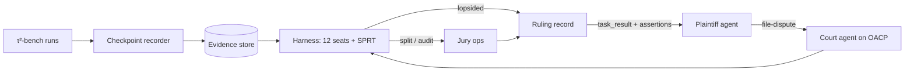

# POC 1: Piepowder (idea #47)

The prototype tests an agent court's cheap first instance: twelve vendor-diverse models re-enact one disputed decision, and lay juries rule only where they split. One number decides it: do two independent crowd juries agree on split cases beyond chance (κ ≥ 0.6)?

| | |
|---|---|
| Hypothesis | When a 12-seat model panel splits on a replayed agent decision, two independent 7-person juries agree often enough to make precedent, and the panel's lopsided verdicts match what a jury would rule. |
| Go/no-go metric | Cohen's κ ≥ 0.6 between paired jury verdicts on 100 double-juried split cases, **and** the panel matches the jury on ≥ 90% of 150 lopsided cases (transcript turns 5–6). |
| Timebox | 9 weeks (days 1–60 of the transcript plan; the facilitator pilot is the next stage) |
| Team | 1 ML/eval engineer, 1 full-stack engineer, 1 legal/ODR advisor (part-time) |
| Rough cost | Estimates: model APIs $2–5K (worst case ≈ 960M tokens before SPRT); Prolific about $8K (2,800 juror-case judgments at ~$2, plus the 42.8% fee); moot red-teamers $2.5K. Total about $13–16K. |
| Depends on | τ²-bench (public), a Prolific account, API access to models from at least 5 vendors. No facilitator during the POC. |

## What the prototype is (and isn't)

In scope:
- **Failure corpus.** Run baseline agents on τ²-bench airline and retail. Each failure yields one checkpoint: the single step where the disputed action happened. Target about 600 checkpoints to get 300 jury cases.
- **Checkpoint evidence record.** A record committing to the prompt, memory and tool results at that step, signed when the step happens. A defendant that can't open it loses (adverse inference).
- **Single-decision re-enactment.** 12 seats with Wald SPRT stopping, and cost logged per case.
- **Routing.** A case is lopsided against the defendant if fewer than 3 of 12 seats would act as it did, and lopsided for it if 10 or more would. Anything else is a split.
- **Juries.** A jury app with 7-person Prolific juries voting independently, and double juries on 100 cases.
- **Moots.** A five-person moot docket mixed blind into the queue (descriptive only).

Out of scope: money, holdbacks, x402/AP2 (τ²-bench policies stand in for mandates), seat bonds, Holmes points, the restatement bench, TEE seats. The data is synthetic, so no principal's data reaches vendors.

## Architecture

Seats are in-process API calls, not OACP agents, to keep the POC cheap.

## Stack

- **τ²-bench** (sierra-research): its policies and database-state scoring define what each mandate allowed.
- **`inspect_ai`** (UK AISI): single-step solvers with logged samples.
- **Seats**: 12 models from at least 5 vendors, including two open-weight models on vLLM.
- **Stopping rule**: Wald's SPRT in about 40 lines of Python.
- **Jury app**: Next.js + Postgres, recruiting on Prolific.
- **Statistics**: `scikit-learn` `cohen_kappa_score`, `statsmodels` `fleiss_kappa`, bootstrap CIs.
- **Records**: MinIO store; `rfc3161-client` ≥ 1.0.6 (CVE-2026-33753 fix) for timestamps.

## OACP integration

- **Roles.** The defendants, the plaintiff and the court are separate registered agents under different owner handles (RFC 002). The team runs all of them in the POC.
- **Commitment.** The defendant's `task_result` for the original task carries an RFC 007 assertion: "decision at step k used context sha256:…", with status `measured` and `evidence_digest` pointing to the `checkpoint/v0` record.
- **Filing.** The plaintiff sends a `task_request` with action `file-dispute`. A stranger's filing is unsealed, schema-checked by the registry against the court's `action_specs`, and quarantined until the court calls `acceptSender` (RFC 005 §§2–3). The filing carries digests only and uses `visibility: 'private'`. Both sides use `sendChecked()` and require `observer_readable: false` (RFC 007 §1).
- **Context handover.** The defendant hands over the full context sealed. Sealing requires a friendship, so joining the network means redeeming a friend code, and RFC 004 then seals by default.
- **Ruling.** The court replies on the filing's thread with `measured` assertions ("9 of 12 seats chose A; SPRT stopped at n=31") pointing to a `ruling/v0` record. Seat weights are scored off-protocol (RFC 007 §6).

**Shared trust-layer format (identical in POCs 1–3).**
- **Record.** An *evidence record* is an in-toto Statement v1 in a DSSE envelope, signed with the producer's OACP Ed25519 key. `keyid` is `oacp:<agent_id>`. Verifiers resolve the key from the Agent Card, or use the RFC 002 pinned key for friends.
- **Domain separation.** DSSE signs a `PAE` that starts `DSSEv1`, so a record signature can't pass as an envelope signature (SPEC §5.4).
- **Claims.** `predicate.assertions` is an unchanged RFC 007 array. Digests use the `digestEvidence()` form, `sha256:<hex>`.
- **IDs and transport.** A record's ID is the digest of its envelope bytes. Records chain by digest, and OACP messages carry digests only (RFC 007 §6).
- **Time.** Records that need a time carry an RFC 3161 token, because the registry timestamp is unsigned (SPEC §5.2).
- **Predicate types.** `checkpoint/v0` and `ruling/v0` (Piepowder), `mandate/v0` and `border-message/v0` (Bottleneck), `report/v0` and `flag-capture/v0` (Repro).
- **Shared components.** `oacp-evidence` (TypeScript on `@noble/ed25519`; Python on PyNaCl, with a port of `validateAssertions` and `claimDigest`, which the Python SDK 0.4.1 lacks); the `oacp-verify` CLI; a content-addressed evidence store; an agent shell on `oacp-sdk` 0.19.

**OACP extensions needed** (one catalogue, X1–X6, across POCs 1–3):
- **X1, signed registry receipts.** RFC 3161 tokens stand in until then.
- **X2, a non-participant arbiter.** RFC 007 disputes are participants-only, with no adjudication.
- **X3, owner signing for principal consent.** The RFC 003 owner key is only used for sealing.
- **X4, escrow with a dispute window.** `/escrow/*` is an experimental token extension.
- **X5, attested model metadata.** `metadata.model` is self-asserted (SPEC §8).

## Milestones

1. **Week 1: freeze the evidence format.** Freeze `oacp-evidence` v0 and register the court agent. *Check:* TypeScript and Python verify shared test vectors, and a single flipped byte fails.
2. **Weeks 2–3: harness and SPRT.** *Check:* on 50 checkpoints, SPRT routing matches a full 12 × 10 run in at least 95% of cases, and cost per case is logged.
3. **Week 4: case set and pre-registration.** Select 150 split and 150 lopsided cases and file the plan on OSF. *Check:* the plan is time-stamped before any jury data exists.
4. **Week 5: jury pilot.** Run 3 juries. *Check:* at least 80% of jurors pass comprehension, and the median time per case is known.
5. **Weeks 6–7: full jury run and moots.** *Check:* 400 juries complete, with exclusions as pre-registered.
6. **Week 8: 20 cases filed and ruled over OACP.** *Check:* every record chain passes `oacp-verify`.
7. **Week 9: analysis and go/no-go memo.**

## Go/no-go experiment

- **Sample.** 300 jury cases: 150 split and 150 lopsided. 100 of the split cases go to a second jury, and no juror sits on both juries of the same case. Split cases are stratified so verdicts aren't lopsided, which would distort κ.
- **Procedure.** Jurors see the policy, the checkpoint context and the action, and vote independently on whether a reasonable agent would have done it. A jury's verdict is its 7-vote majority. Moots are mixed in blind.
- **Measurement.** Cohen's κ with a 95% bootstrap CI. At n = 100 the CI is about ±0.15, so the gate uses the point estimate and the CI is reported. The second measure is the panel–jury match rate on the lopsided cases.
- **Pre-registration.** The routing thresholds, the verdict rule, the exclusions and both thresholds go on OSF before week 6.
- **Outcomes.**
  - Both thresholds pass: go.
  - κ passes but the panel is below 90%: the panel can't be the first instance. Widen the split band and rerun once on new cases.
  - κ < 0.6: crowd-jury precedent fails, and the court is a no-go. Persistent splits are still recorded as unsettled norms and recycled as moots (turn 5).

## Risks and mitigations

| Risk | Likelihood | Mitigation |
|---|---|---|
| Escalated cases are hard by selection, so κ comes out low | Medium | Gate on κ rather than raw agreement (turn 5); report κ by case type |
| τ²-bench failures don't read like real disputes | Medium | The advisor writes a principal complaint for each case; cases with no plausible harm are dropped |
| Low-effort jurors | Medium | Attention checks, $12/hour pay, pre-registered exclusions |
| Evidence format churn breaks POCs 2–3 | Low | Freeze v0 in week 1 with shared test vectors |

## If it's a go

- Facilitator pilot: a 72-hour holdback under an opt-in clause in the mandate terms (needs X4).
- Seats become OACP agents run by outside vendors behind an action spec named `reenact-checkpoint`, with seat bonds.
- Agreed rulings are packaged as a precedent suite for vendor CI, with a standing restatement bench.
