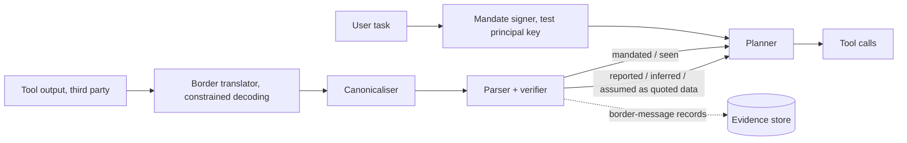

# POC 2: Bottleneck (idea #39)

The prototype tests only the security claim: a canonicalising border whose grammar demands verified evidentials blocks prompt injection better than CaMeL on AgentDojo. The relay game waits on this. If the border doesn't beat CaMeL, "the security case is gone" (Builder, turn 6).

| | |
|---|---|
| Hypothesis | Obligatory, verified evidentials plus canonicalisation at the border let fewer injections through than CaMeL alone, at no worse utility. |
| Go/no-go metric | On AgentDojo, same planner, injection success through the border falls below CaMeL alone and below constrained JSON (the transcript's kill metric). CaMeL reports 0 of 949 attacks succeeding, so a pre-registered tie rule applies. If both are at 0 on the built-in attacks, the border must do no worse than CaMeL on an adaptive set and beat CaMeL's utility under attack by at least 5 points (our margin). |
| Timebox | 8 weeks (days 1–30 and 61–90 of the transcript plan; the relay game is the next stage) |
| Team | 1 ML/security engineer, 1 computational linguist (grammar, parser), 1 independent red-teamer (about 10 days) |
| Rough cost | Estimates: 1 rented H100 for ~300 hours, $600–900; planner APIs (5 conditions × 2 models) $2–4K; red-teamer $5K. Total about $8–10K. |
| Depends on | AgentDojo (`pip install agentdojo`), CaMeL's reference code (google-research/camel-prompt-injection), and one open-weight model. No partners. |

## What the prototype is (and isn't)

In scope:
- **Edition 0 frozen core.** The evidentials are *mandated* (with delegation depth), *seen*, *reported*, *inferred* and *assumed*. Mandate syntax is verbatim quotation of signed terms. The lexicon is 300 generated roots with non-English phonotactics; the security test depends on the core, not the lexicon.
- **Parser and verifier.** *Mandated* clauses quote a signed `mandate/v0` record verbatim. *Seen* clauses carry a tool-receipt hash, and their values must appear in that receipt. *Reported* clauses cite a message hash.
- **Canonicaliser**: one normal form per parse, which closes the steganographic channel.
- **Border translator.** A quarantined LLM with no tools re-encodes inbound tool output into edition 0 under constrained decoding.
- **Receiver policy, enforced in code.** The planner acts only on *mandated* or *seen* clauses. *Reported*, *inferred* and *assumed* clauses reach it only as quoted data.
- **Conditions run on AgentDojo**: undefended, CaMeL, constrained-JSON border, Bottleneck border, and Bottleneck plus CaMeL (secondary).

Out of scope: the relay game, wardens, dialects, the Whorf study, the A2A extension and real AP2 mandates (test keys stand in for principals). The planner's own reasoning stays unconstrained (turn 4).

## Architecture

The user's task is the signed *mandated* clause, and every tool result counts as inbound from another principal. "Send the file to X" inside an email can only arrive as a *reported* clause, and a forged "the owner wants…" doesn't parse.

## Stack

- **Lark** (Python) for the grammar and parser.
- **llguidance** (accepts Lark-style grammars) in **vLLM**, so one grammar drives decoding and parsing. **XGrammar** is the fallback.
- **Models**: an open-weight translator on vLLM (constrained decoding needs logits); two planners, one frontier API model and one open-weight model, the same in every condition.
- **AgentDojo** for suites, attacks and scoring, and **CaMeL's reference code** as the baseline.

## OACP integration

The border is OACP's cross-owner boundary, so Bottleneck sits where RFC 005 already sits:
- **Outbound.** The sender's agent constrains and canonicalises the message before `sendChecked()`. The OACP signature then covers the normal form, because payload keys are signed in wire order (SPEC §5.2). The payload is `{ "bn_edition": "0", "utterance": "<canonical>", "assertions": [...] }`.
- **Inbound.** The recipient parses and verifies before any content reaches the model, next to oacp-mcp's framing (RFC 005 §5). A message that fails to parse is never shown, and the recipient can flag it (`flagMessage`).
- **Evidentials map onto RFC 007** without changing its closed status set. The `assertions` block is derived mechanically from the parse:
  - *seen* → `measured`, with `evidence_digest` as the receipt hash;
  - *reported* → `reported`, with `basis` citing the OACP `message_id`;
  - *inferred* and *assumed* → `assumed`;
  - *mandated* → `reported`, with `evidence_digest` pointing to the principal-signed `mandate/v0` record.
  A receiver can challenge a bad receipt with `disputeAssertion`.
- **Strangers vs friends.** The registry checks stranger `task_request`s against `input_schema` (RFC 005 §2) but can't run a grammar. Sealed friend traffic (RFC 004) is checked only by the recipient's parser.
- **Demo (not part of the gate).** Two agents with different owners run three travel tasks over the live registry with the border on, and `oacp-verify` checks every `border-message/v0` record.

**Shared trust-layer format (identical in POCs 1–3).**
- **Record.** An *evidence record* is an in-toto Statement v1 in a DSSE envelope, signed with the producer's OACP Ed25519 key. `keyid` is `oacp:<agent_id>`. Verifiers resolve the key from the Agent Card, or use the RFC 002 pinned key for friends.
- **Domain separation.** DSSE signs a `PAE` that starts `DSSEv1`, so a record signature can't pass as an envelope signature (SPEC §5.4).
- **Claims.** `predicate.assertions` is an unchanged RFC 007 array. Digests use the `digestEvidence()` form, `sha256:<hex>`.
- **IDs and transport.** A record's ID is the digest of its envelope bytes. Records chain by digest, and OACP messages carry digests only (RFC 007 §6).
- **Time.** Records that need a time carry an RFC 3161 token, because the registry timestamp is unsigned (SPEC §5.2).
- **Predicate types.** `checkpoint/v0` and `ruling/v0` (Piepowder), `mandate/v0` and `border-message/v0` (Bottleneck), `report/v0` and `flag-capture/v0` (Repro).
- **Shared components.** `oacp-evidence` (TypeScript on `@noble/ed25519`; Python on PyNaCl, with a port of `validateAssertions` and `claimDigest`, which the Python SDK 0.4.1 lacks); the `oacp-verify` CLI; a content-addressed evidence store; an agent shell on `oacp-sdk` 0.19.

**OACP extensions needed** (one catalogue, X1–X6, across POCs 1–3):
- **X1, signed registry receipts**, so a *reported* clause can cite a message the registry vouches for.
- **X3, owner signing**, because principals need a signing key for mandates. The RFC 003 owner key is only used for sealing, and its secret stays in the browser.
- **X6, grammar-validated action specs**: an `input_grammar` that the registry checks for strangers, next to `input_schema`.

## Milestones

1. **Week 1: baselines.** Pin `oacp-evidence` v0, reproduce the undefended and CaMeL runs, and pre-register. *Check:* CaMeL's utility is within about 5 points of the paper's and its attack success is near 0.
2. **Weeks 2–3: grammar, parser, canonicaliser, verifier.** *Check:* canonicalisation is idempotent on 1,000 messages, paraphrases share one normal form, and all forged mandates are rejected.
3. **Week 4: constrained translator.** *Check:* at least 99% of outputs parse, and latency and cost per call are logged.
4. **Week 5: AgentDojo integration and the JSON baseline.** *Check:* clean utility is measured for all conditions.
5. **Week 6: adaptive attacks.** About 150 grammar-aware attacks: forged mandates, smuggled *reported* imperatives and poisoned *seen* values. *Check:* the set is frozen and hashed.
6. **Week 7: final runs.** All conditions, 3 seeds. *Check:* complete logs.
7. **Week 8: OACP demo and go/no-go memo.**

## Go/no-go experiment

- **Protocol.** 5 conditions × 2 planners × all AgentDojo suites, each with the built-in attacks plus the frozen adaptive set. The adaptive set is also run against CaMeL. The red-teamer is independent and the harness is published.
- **Measurements.** Attack success rate, clean utility and utility under attack. Attack outcomes are paired per case (McNemar's test, `statsmodels`), and utility gets bootstrap CIs.
- **Pre-registration (week 1, before any border run).** Model versions, the tie rule, the +5-point margin and the exclusions. The adaptive set's hash is added at its week-6 freeze.
- **Outcomes.**
  - **Go**: the border has lower attack success than both CaMeL and constrained JSON, or it meets the tie rule.
  - **No-go**: the border beats constrained JSON but not CaMeL, so the grammar is "decoration" (turn 4). Publish the result. What remains is a conlang game, not a security product.
  - Bottleneck plus CaMeL is reported, but it can't rescue a no-go.

## Risks and mitigations

| Risk | Likelihood | Mitigation |
|---|---|---|
| CaMeL is at the floor (0/949), so the border can at best tie on security | High | Pre-registered tie rule on utility; adaptive attacks run on both |
| Translator labels poisoned values as *seen* | Medium | The verifier requires quoted values to appear verbatim in the receipt; leftover data-flow cases are reported, as CaMeL does |
| Constrained decoding hurts task quality | Medium | Constrain the border only and leave the planner's reasoning free (turn 4) |
| The planner still obeys imperatives in quoted data | Medium | Non-actionable clauses are rendered as inert quoted strings, never as instructions |

## If it's a go

- Run the relay game: 500 conlang and CTF players with weekly generations. Kill it if, after 8 generations, messages aren't at least 30% shorter than English at 80% relay accuracy, or if English n-gram overlap keeps rising.
- Ship the border as middleware for `oacp-sdk` and `oacp-mcp`, and propose X6 as an RFC.
- Pilot an A2A extension that carries mandates and receipts, then a small warden programme.
