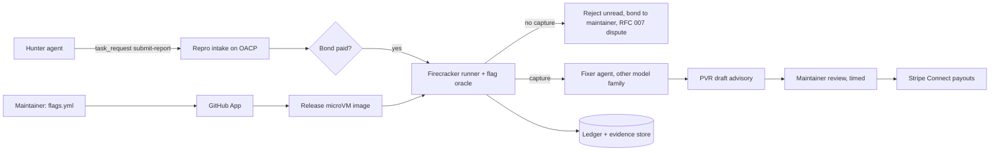

# POC 3: Repro (idea #45)

The prototype tests whether a sandbox with maintainer-declared flags, plus a $5 bond to file, filters junk bug reports unread while letting real ones through. The deciding number: more than 30% of bonded reports valid, at under 20 minutes of maintainer review each. curl's rate was below 5%.

| | |
|---|---|
| Hypothesis | If a report must capture a planted flag before a human reads it, and filing costs a bond, the reports maintainers see are mostly real and quick to review. |
| Go/no-go metric | Three conditions from turn 4, all required: valid rate above 30% of bonded reports, median maintainer review under 20 minutes, and at least one ratified amendment. Our added guard: at least 90% of a calibration set of known-real vulnerabilities captures a flag. |
| Timebox | 12 weeks (the transcript's 90 days) |
| Team | 1 security/infra engineer, 1 full-stack engineer, 1 maintainer liaison (part-time) |
| Rough cost | Estimates: 2 bare-metal KVM hosts for 3 months, $1–2K; reviews ($50–150 × 40–60), $3–8K; finder pool, $10–15K. Total about $15–25K. |
| Depends on | 10 opted-in OSS-Fuzz projects with GitHub private vulnerability reporting (PVR) on, and 5 AIxCC alumni teams. An Alpha-Omega grant helps but isn't required. |

## What the prototype is (and isn't)

Safety frame: this is defensive work on opted-in projects. Reproducers run only in Repro's own sandboxes, against tagged releases, with no network egress. Every flag is local: fake secrets with fresh nonces, and mock endpoints. Reproducers stay private until patched and go only through PVR.

In scope:
- **Flag kits.** For C: libFuzzer + ASan, plus file and exec canaries. For Python: path-traversal, SSRF and deserialization canaries. Flags are declared in `.repro/flags.yml`.
- **Intake** through OACP and a web form, with a $5 Stripe bond that falls as a reporter's valid rate rises.
- **Sandbox runner and flag oracle.** The oracle decides captures. No capture means the report is rejected unread and the bond goes to the maintainer.
- **Finder–fixer split.** A fixer from another model family writes the patch, which must block the capture and pass the tests. Maintainers review a PVR draft advisory, timed.
- **Amendment lane** for out-of-model captures. Refusal still sends the bug to private disclosure.
- **Ledger v0**: flag, price and measured sandbox-hours held. Every line says "evidence of effort, not a guarantee of safety".

Out of scope: x402 bonds, downstream pools, the SBOM dashboard, manufacturer pricing, and logic/web bugs. KYC is avoided by capping payouts below $500. Payouts on code changed in the last 180 days are held.

## Architecture

## Stack

- **GitHub App** (Probot), with the GitHub API for private vulnerability reports and advisories.
- **Firecracker** microVMs with the jailer and a seccomp profile, on bare-metal KVM hosts.
- **ClusterFuzzLite** for building the C harnesses, and **pytest** harnesses for Python.
- **Flag oracle**: nonce-bearing secret files, a local HTTP sink for SSRF, **Falco** exec rules, and a canary AWS key that works only against a local **moto** server.
- **Calibration set** from **ARVO** (reproducible OSS-Fuzz vulnerabilities) and GHSA advisories on the pilot projects' older tags.
- **Stripe Connect** for bonds and payouts, and **MinIO** for the evidence store.

## OACP integration

- **Intake is an OACP agent.** Its action `submit-report` has an `input_schema` (repo, tag, commit, flag id, `reproducer_digest`, upload URL, `bond_ref`). Hunters are strangers, so the registry rejects malformed requests (`invalid_payload`, `unknown_action`) before Repro sees them (RFC 005 §2). First contact is quarantined until Repro calls `acceptSender`. It does so once the team's owner has paid a bond tied to the `agent_id`.
- **The exploit never travels in a message.** A stranger's `task_request` must be unsealed (RFC 005 §2). So the payload carries only the digest and a presigned upload URL. It uses `visibility: 'private'` and `ttl_seconds`, and the hunter checks that the receipt shows `observer_readable: false` (RFC 007 §1). After onboarding, a friend code makes follow-ups sealed by default (RFC 004).
- **A report is an RFC 007 claim.** For example: "reproducer sha256:… captures flag F against repo@v1.2.3", with status `measured`, a method and `evidence_digest`. Repro replies with its own `measured` assertion that cites a `flag-capture/v0` record signed by the runner's agent key. If nothing is captured, Repro, as a thread participant, calls `disputeAssertion` with verdict `refuted` and its own `measured` run as the counter-assertion. The hunter gets one `respondToDispute`. Under RFC 007 §6.1 a refuted `measured` claim costs double, so slop farms lose public accuracy. Bond pricing uses Repro's own valid rate, with `GET /reputation` as a cross-check.
- **Fixer.** The fixer is a separate agent discovered by capability `security-patch`. Its model family is read from `metadata.model`, which is self-asserted.

**Shared trust-layer format (identical in POCs 1–3).**
- **Record.** An *evidence record* is an in-toto Statement v1 in a DSSE envelope, signed with the producer's OACP Ed25519 key. `keyid` is `oacp:<agent_id>`. Verifiers resolve the key from the Agent Card, or use the RFC 002 pinned key for friends.
- **Domain separation.** DSSE signs a `PAE` that starts `DSSEv1`, so a record signature can't pass as an envelope signature (SPEC §5.4).
- **Claims.** `predicate.assertions` is an unchanged RFC 007 array. Digests use the `digestEvidence()` form, `sha256:<hex>`.
- **IDs and transport.** A record's ID is the digest of its envelope bytes. Records chain by digest, and OACP messages carry digests only (RFC 007 §6).
- **Time.** Records that need a time carry an RFC 3161 token, because the registry timestamp is unsigned (SPEC §5.2).
- **Predicate types.** `checkpoint/v0` and `ruling/v0` (Piepowder), `mandate/v0` and `border-message/v0` (Bottleneck), `report/v0` and `flag-capture/v0` (Repro).
- **Shared components.** `oacp-evidence` (TypeScript on `@noble/ed25519`; Python on PyNaCl, with a port of `validateAssertions` and `claimDigest`, which the Python SDK 0.4.1 lacks); the `oacp-verify` CLI; a content-addressed evidence store; an agent shell on `oacp-sdk` 0.19.

The in-toto/DSSE choice matches the transcript's Sigstore and in-toto stack, so ledger records can go to Rekor later.

**OACP extensions needed** (one catalogue, X1–X6, across POCs 1–3):
- **X1, signed registry receipts.** The 180-day hold and ledger hours need trusted times; RFC 3161 tokens stand in until then.
- **X4, escrow with forfeit to a third party.** This would let bonds move to agent rails. `/escrow/*` is experimental and its semantics aren't in SPEC.
- **X5, attested model metadata**, to enforce the finder–fixer family split.

## Milestones

1. **Weeks 1–2: kits and runner.** Build the flag kits and the Firecracker runner, and pin `oacp-evidence` v0. *Check:* each flag type is captured by a known exploit against a toy app, with zero false captures in 100 benign runs.
2. **Weeks 3–4: projects and calibration.** Sign up 10 projects and declare their flags. Build a calibration set of 20 known-real vulnerabilities on older tags. *Check:* at least 90% of the calibration set captures a flag; otherwise revise the kits.
3. **Week 5: end to end.** Wire up the GitHub App, PVR routing, OACP intake, Stripe bonds and the fixer. *Check:* a full dry run passes with a test hunter.
4. **Weeks 6–11: closed beta** with five AIxCC alumni teams and the amendment lane open. In weeks 7–8 a control stream of LLM-written slop tests rejection; it is kept out of the valid rate. *Check (weekly):* valid rate, review time, false rejects.
5. **Week 12: results.** Publish ledger v0, run the analysis and write the go/no-go memo.

## Go/no-go experiment

- **Pre-register before week 6:**
  - *Valid*: the maintainer confirms a real in-model vulnerability, or ratifies an amendment.
  - *Valid-rate denominator*: every organic bonded report, auto-rejects included.
  - *Review time*: an in-app timer, cross-checked against advisory event timestamps.
- **Sample.** Target at least 60 bonded reports. Fewer than 30 is inconclusive, and the beta is extended once by 4 weeks.
- **False-reject check.** Our engineer, not the maintainers, reviews 20% of auto-rejects. Real bugs found there go to private disclosure. With the calibration set, this tests "letting real ones through".
- **Outcomes.**
  - All three thresholds plus the guard pass: go.
  - Valid rate passes but review time fails: shrink the review packet and rerun for 4 weeks.
  - Valid rate at or below 30%: bonds and flags don't deter slop, so stop.
  - No ratified amendment: the threat model can't grow, so the next stage is restricted to flag kits.

## Risks and mitigations

| Risk | Likelihood | Mitigation |
|---|---|---|
| Maintainers won't write flags | High | We draft them from templates and maintainers only approve |
| Too few reports | Medium | Subsidised sandbox hours; pre-registered minimum; one extension |
| False captures or sandbox escape | Low | The oracle decides captures, nonces are fresh per run, and the jailer, seccomp and no egress contain the run |
| Plant-then-find (xz-style) | Low | A 180-day hold on recently changed code, git-blame checks against linked identities, and a payout cap |
| A reproducer leaks | Medium | Digests only on OACP, PVR only, TTLs, and access logs on the evidence store |

## If it's a go

- Test the step that broke Tidelift: one downstream company funds a pool and buys the SBOM-to-flag dashboard.
- x402 bonds for agents, possibly on OACP once X4 exists.
- Cross-project flag templates, and ledger records published to Sigstore Rekor.
