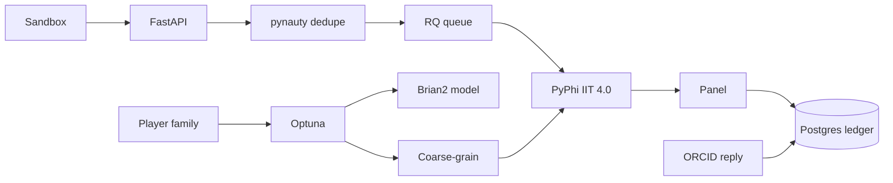

# POC 4: Litmus Ghost (idea #3)

The prototype tests whether a small public instrument can turn a consciousness theory's own published commitments into scoring code that players can break, and whether the theory's authors will answer on the record. The deciding number is how many theory teams respond publicly to a verified counterexample. If none do, Litmus Ghost is a philosophy game, not an instrument.

| | |
|---|---|
| Hypothesis | If verified Hollow and Overlooked counterexamples against IIT 4.0 are logged against the theory's own quoted commitments, with a working right of reply, at least one theory team will respond publicly. |
| Go/no-go metric | Pre-registered. At least 1 theory team responds publicly to a specific verified counterexample by week 16, when the response window closes. Zero is a no-go. |
| Timebox | 16 weeks: 12 to build and run season 0, then a 4-week response window. |
| Team | 1 full-stack engineer (Python, TypeScript). 1 research lead in consciousness science or philosophy of mind (half time). 3 grad students drafting claims (part-time, weeks 1–8). A 3-person review panel with one IIT-sympathetic member. |
| Rough cost | Estimates: $20K bounty pool. About $15K for claim drafting. About $6K for panel honoraria. About $2K for compute and hosting. Roughly $45K plus the engineer and lead. |
| Depends on | A seed funder for the bounty (Templeton World Charity Foundation's ARC program is the natural one) and PyPhi's IIT 4.0 branch. No theory-team consent is needed to start. |

## What the prototype is (and isn't)

In scope:
- A claims database of about 150 sourced commitments from IIT 4.0, GNW and higher-order theories (HOT), each with a verbatim quote, DOI, page and scope note.
- A machine-scored spec for **IIT 4.0 only**: PyPhi on networks of at most 12 nodes.
- **Hollow** mode: a network that scores high Φ while plainly mechanical. **Overlooked** mode: a network that scores Φ = 0 while showing the hallmarks the theory claims to explain. The software computes Φ. The panel judges the other half against a written rubric.
- Isomorphism dedupe, panel review, and verdicts (*patched*, *conceded*, *bullet bitten*, *awaiting reply*), each with a right of reply.
- An **untestable** badge on GNW and HOT, which have no computable spec yet. Reports count bullets per computable commitment.
- A Discovery prototype for IIT vs. GNW, built only on the lab-published Dehaene–Changeux model.

Out of scope:
- Contradiction mode, and scored modes for GNW or HOT. Revisit after season 0.
- Agent societies and social graphs. GNW is never applied to a message graph.
- The Lean-style graph, a live progressiveness index and any AI-welfare lookup.
- Any claim that a system is or isn't conscious. It tests operationalizations only.
- OACP. Nothing here needs agents owned by different people to message each other.

## Architecture

The API canonicalizes each submitted network (nodes, edges, a mechanism per node) and checks it for duplicates before spending compute. Unique entries go to a capped queue. A PyPhi worker scores them, the panel reviews the ones that clear the threshold, and verdicts and replies go to the ledger. In Discovery, players propose a parameter family inside the Dehaene–Changeux model. An optimizer sweeps it, scoring GNW ignition in Brian2 and IIT on a versioned coarse-graining to ≤12 binary nodes, and keeps the candidates where the theories' rank-normalized scores split most. The coarse-graining is a contestable choice, so it is published and open to reply.

## Stack

- **PyPhi, `feature/iit-4.0` branch, pinned commit.** It is the reference implementation. PyPI's 1.2.0 (2019) is IIT 3.0.
- **Brian2 2.11** for the Dehaene–Changeux workspace model (Dehaene, Sergent and Changeux, PNAS 2003). It needs Python 3.13 or later, so the workers run in separate containers.
- **pynauty 2.8.8.1** for canonical labeling, with vertices colored by mechanism.
- **Postgres 16.** NOT NULL constraints on DOI, page and quote.
- **FastAPI, Redis + RQ** with node and wall-clock caps. **React + React Flow** for the graph builder.
- **Optuna** for Discovery, following the "controversial stimuli" objective (Golan, Raju and Kriegeskorte, PNAS 2020).
- **ORCID OAuth** ties each reply to a verified researcher. **OSF Registries** for pre-registration.

## Milestones

1. **Weeks 1–2: schema and compute.** Reproduce the IIT 4.0 paper's notebook examples and benchmark runtime at 6–12 nodes. *Check:* the examples match, and a cap is set at which 95% of jobs finish.
2. **Weeks 3–4: claims and GNW model.** Draft 150 claims, each checked by a second student. *Check:* zero misquotes in a 30-claim spot check, and the model reproduces the 2003 paper's all-or-none ignition.
3. **Weeks 5–6: Hollow and Overlooked.** Build the sandbox, dedupe, scoring and rubric. *Check:* seed cases behave as published. An Aaronson-style XOR grid scores high Φ for its size. A feedforward twin (Doerig et al. 2019) scores Φ = 0.
4. **Weeks 7–8: ledger and reply.** Build the badges and the reply flow. Run a 30-player closed beta, invite a liaison from each theory community, and pre-register on OSF. *Check:* an outside tester completes a reply end to end.
5. **Weeks 9–12: season 0.** Open to philosophy and ML students and LessWrong, with the $20K pool. Ship Discovery. Send each verified case to its authors on sign-off. *Check:* at least 3 verified non-isomorphic cases, and Discovery's top 10 published.
6. **Weeks 13–16: response window.** Publish the season report. *Check:* the go/no-go decision.

## Go/no-go experiment

**Pre-registration.** Before season 0 opens, file the definitions, window and threshold on OSF.

**Definitions.** A *theory team* is a lab with an author on a cited source paper, or a person that lab names, counted once. A *public response* is a right-of-reply entry, a verdict, a spec patch, or a public post, preprint or talk that addresses a specific verified case. Private emails are logged but don't count.

**Precondition.** At least 3 verified, non-isomorphic cases against IIT 4.0. Fewer is a separate no-go: players couldn't produce counterexamples.

**Procedure.** Email each case to the corresponding authors, with its draft verdict marked *awaiting reply* and the reply link. It goes public after a 30-day embargo, with a reminder at day 14. The letter also invites each theory to publish a computable spec and shed its badge. The last cases go out by week 12.

**Outcomes.**
- **0 teams respond:** no-go. Release the claims database as an open dataset and stop.
- **At least 1 response of any kind:** go. A dismissive reply still counts, and it is recorded verbatim.
- **A verdict or spec patch:** strong go.
- **A team publishes a spec voluntarily to shed the badge:** the strongest signal, the one the Builder said would raise feasibility.

Reported but not deciding: submissions, dedupe rate, panel agreement (Cohen's kappa) and the spread of Discovery's top candidates.

## Risks and mitigations

| Risk | Likelihood | Mitigation |
|---|---|---|
| Theory teams ignore it | High | Liaison invitations, quote-only attribution and a one-click reply. The kill metric tests it first. |
| Feuds over "bullet bitten" without consent | Medium | It is recorded only with a verbatim author quote. Otherwise *awaiting reply*. A 30-day embargo and a sympathetic panelist. |
| PyPhi IIT 4.0 is too slow or unstable | Medium | Pinned commit, a week-1 benchmark, hard caps. |
| Precision penalty: IIT takes every hit | High | Bullets per computable commitment. GNW and HOT are badged untestable, not clean. |
| Isomorphic spam and bounty gaming | Medium | Mechanism-colored canonical forms. Bounties are paid per equivalence class. |
| Verdicts used as AI-welfare PR | Low | No welfare lookup. No lab money in season 0, and any later lab money is firewalled. |

## If it's a go

- Apply to TWCF's ARC program for the roughly $400K-a-year instrument.
- Season 1: Contradiction mode on IIT 4.0's machine-checkable commitments, plus scored modes for any theory that publishes a spec.
- Offer Discovery's top candidates to INTREPID-style collaborations as preregistered stimuli.
