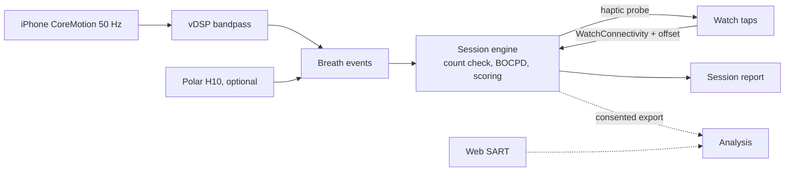

# POC 5: Caught (idea #9)

The prototype tests whether breaths-to-catch measures attention or only measures getting good at the app. It is an eyes-closed iOS and Watch practice built on the Levinson breath-counting task. The deciding number is the four-week transfer test: breaths-to-catch must shrink, and the change must track an independent SART score. If it doesn't, Caught is a pleasant metronome.

| | |
|---|---|
| Hypothesis | Over four weeks of practice, breaths-to-catch falls, and each person's change tracks their change on an independent Sustained Attention to Response Task (SART). |
| Go/no-go metric | Two pre-registered tests. **Product kill:** breaths-to-catch doesn't shrink over four weeks while tracking SART. That is, the mixed-effects slope isn't below zero, or ρ(Δbreaths-to-catch, ΔSART commission errors) is under 0.2 or its 95% CI includes 0. **Feature kill:** tap jitter predicts probe-caught drift at AUC < 0.6, so jitter is dropped. |
| Timebox | 13 weeks: 12 to build and run, 1 to analyze. |
| Team | 1 iOS/watchOS engineer. 1 data scientist with psychometrics experience (half time). A meditation teacher (advisor). A clinical psychologist on call for adverse effects. |
| Rough cost | Estimates: about $400 for 4 Polar H10 straps. About $1.5K for test devices. $1K for 20 validation participants. About $7.5K for cohort incentives ($25 × 300). $2–5K for IRB review. The Apple developer fee is $99. Roughly $13–16K plus staff. |
| Depends on | Nothing external. The IRB is needed only because the cohort is a research study. |

## What the prototype is (and isn't)

In scope:
- An iPhone app that reads respiration phase lying on the belly, and a Watch app for taps and haptic probes.
- The counting loop. One tap per breath, a distinct tap on ten, and a self-catch gesture.
- Three layers of evidence. Count breaks and rare probes are hard evidence. Hidden tap jitter back-dates onset and is labelled only "likely".
- Game rules. Self-caught drifts are returns that earn progress. Probe-caught drifts are the only setback.
- A session report with breaths-to-catch and the self-caught ratio.
- A Polar H10 path as the validation reference and premium sensor.
- A standalone web SART given outside the app.

Out of scope:
- EEG and any BCI input.
- Visible Perfect/Good/Late timing grades (Goodhart).
- Ghost sits and teacher lineage.
- Leaderboards, duration stats and employer dashboards.
- ADHD, anxiety or other health claims. This is a wellness app, not a medical device.
- Cloud processing of attention data. The product runs on-device. Only consenting study participants upload de-identified session summaries.
- OACP. A single-user, on-device app has no agents talking to each other.

## Architecture

The phone samples motion at about 50 Hz, band-passes the tilt signal to 0.1–0.5 Hz and detects end-of-exhale peaks. Those breath events are the ground-truth clock. The Watch timestamps taps. A ping-pong clock offset, measured at the start of a session and rechecked during it, maps them onto phone time. The phone's session engine matches taps to breaths, flags count breaks, runs the change-point model on tap-minus-breath offsets, schedules probes and scores the session.

## Stack

- **Swift 6, SwiftUI, watchOS**, running natively on the sensors and the haptics.
- **CoreMotion device motion at ~50 Hz, with Accelerate/vDSP biquads** for the on-device bandpass.
- **`WKExtendedRuntimeSession` (mindfulness)** keeps the Watch app live and able to play haptics during an eyes-closed sit.
- **WatchConnectivity** carries taps and does NTP-style offset estimation, keeping the samples with the lowest round-trip time.
- **Polar BLE SDK 6.x.** The H10 streams ECG at 130 Hz and accelerometer data at 50 Hz.
- **Bayesian online change-point detection (Adams and MacKay 2007)** in Swift. It is small, explainable and on-device.
- **jsPsych SART:** digits 1–9, withhold on 3, 225 trials. It runs independently of the app.
- **TestFlight** for the cohort, plus **pandas, statsmodels and scikit-learn** for analysis and **OSF** for pre-registration.

## Milestones

1. **Weeks 1–2: sensing harness.** Respiration pipeline, H10 recording, Watch taps and clock calibration. *Check:* matched phone and H10 recordings from three team members.
2. **Weeks 3–4: validation (n = 20).** Phone on belly vs. the H10, eyes closed. These gates are this plan's choices, since the transcript sets none. Breath sensitivity and PPV at least 95%. Median end-of-exhale timing error at most 300 ms. Clock error at most 50 ms. *Check:* if any gate fails, the H10 becomes required for the study.
3. **Weeks 5–6: the loop.** Taps, the ten-tap, self-catch, returns and setbacks. Poisson probes with a mean interval of about 3 minutes, answered "here" or "away". Safety: a 20-minute cap, a check-in after each sit with resources and an easy stop, and an adverse-event log. *Check:* no timing grade appears anywhere in the UI.
4. **Weeks 7–8: jitter model and freeze.** Tune the priors on pilot sits, freeze the model and record its hash. Pre-register, get IRB approval and finish the SART. *Check:* the hash is on OSF before the cohort starts.
5. **Weeks 9–12: cohort.** Recruit 300 adults. Randomize 225 to the app and 75 to a waitlist that takes the SART twice, which estimates the SART's practice effect. SART on day 0 and day 28. The clinical advisor reviews adverse events weekly. *Check:* on track for at least 100 completers.
6. **Week 13: analysis and decision.**

## Go/no-go experiment

**Pre-registration (OSF, before week 9):** the outcomes, the frozen model hash, exclusions, the analysis code and the thresholds.

**Definitions.** A *completer* has at least 12 sessions over 4 weeks and both SARTs. *Breaths-to-catch*, the primary outcome, is the number of sensor-detected breaths from the first count break to the self-catch. A catch with no break counts as 0. A secondary version back-dates onset with jitter. A *probe-caught drift* is an "away" answer with no self-catch in the previous 10 s.

**Test A, jitter (decides a feature).** The predictor is the change-point posterior over the 5 breaths before each probe. The label is "away" vs. "here". Compute AUC with a participant-clustered bootstrap CI. Keep jitter only if AUC is at least 0.6 and the CI's lower bound is above 0.5. Otherwise ship with count breaks and probes only.

**Test B, transfer (decides the product).** Among completers:
1. In a mixed-effects model of log(1 + breaths-to-catch) on week, with random slopes, the slope is below zero and its CI excludes zero.
2. The Spearman ρ between Δbreaths-to-catch and ΔSART commission errors is at least 0.2, with the CI's lower bound above 0. About 100 completers give roughly 80% power for ρ = 0.25 (one-sided, α = 0.05).

Both must hold. If (1) passes and (2) fails, players are getting better at the app, not at attention: it's a toy, no-go. If (1) fails, nothing is being trained: no-go. The waitlist comparison is reported but doesn't decide, since it is underpowered. Also reported: retention, adverse events, the self-caught ratio, and signs of breath pacing, such as unusually regular breath intervals.

## Risks and mitigations

| Risk | Likelihood | Mitigation |
|---|---|---|
| Phone respiration or Watch latency is too noisy | Medium | Week 3–4 gates. H10 as a required fallback. In-session clock rechecks. |
| The score measures app skill, not attention | Medium | The independent SART decides. The waitlist arm estimates the practice effect. |
| Players pace their breathing to their taps | Medium | Jitter stays hidden, with no timing grades. The pacing check is reported. |
| False drift accusations | Medium | Only self-catches and probes score. Jitter is "likely" and never a setback. |
| Adverse effects (Britton, *Varieties of Contemplative Experience*) | Low–Medium | The cap, no duration leaderboards, check-ins, a clinical advisor and IRB oversight. |
| Churn leaves too few completers | High | Over-recruit, tie incentives to the day-28 SART and monitor weekly. |

## If it's a go

- A larger replication against an active control (paced tapping with no catch mechanics) before any public performance claim.
- A subscription beta at about $70 a year, on-device only, with no individual employer or insurer access written into the terms.
- Optional audio ghost sits. Teacher lineage in year two.
