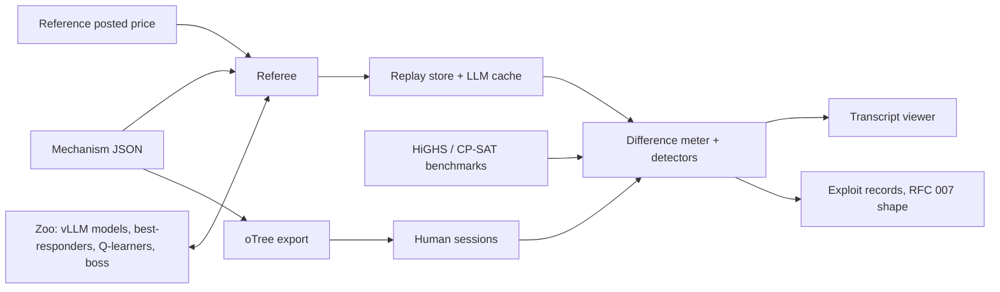

# POC 6: Smoke-Filled Room (idea #8)

The prototype proves that a mixed adversary zoo is strong and realistic enough to grade auction designs. Two results decide it. The zoo must rediscover at least 3 of the 4 museum exploits unaided, and designs that beat the zoo must also do better against real humans in oTree. If either fails, it is a toy.

| | |
|---|---|
| Hypothesis | A mixed zoo, scored by the difference meter, finds the known exploits in historical auction disasters and ranks designs the way human bidders do. |
| Go/no-go metric | Both must pass. (1) A frozen, level-agnostic zoo rediscovers ≥3 of 4 museum exploits under pre-registered detectors. (2) In oTree sessions, zoo-patched designs cut the human revenue shortfall compared with the original designs (paired one-sided Wilcoxon, p < 0.05, pooled), and the direction matches the zoo in ≥3 of 4 levels. |
| Timebox | 12 weeks (14 if human sessions move to the January term) |
| Team | 1 full-stack/ML engineer; 1 market-design economist (part-time, about 1 day a week); an experimental-economics lab contact |
| Rough cost | Estimates: GPU rental for vLLM $500–1,000; frontier API for bosses $300–800; about 120 human participants at $20–25 each, $2,500–3,000. Total about $3.5–5k. |
| Depends on | IRB/ethics approval at a partner university, or for Prolific; one lab or course to host sessions. January-term pilot courses help but are off the critical path. |

## What the prototype is (and isn't)

In scope:
- A JSON mechanism DSL and Python referee for two families.
  - **Sealed-bid** covers New Zealand 1990 and Australia 1993.
  - **Simultaneous multiple-round ascending (SMRA)** covers the Netherlands 2000 and US West 1997.
  - The knobs are payment rule, reserve, default penalty, increments, bid revelation, activity rule, chat on or off, and lot count.
- Four museum levels. Each has an exploit detector frozen before any zoo run.
- The zoo: two or three small open-weight LLMs, scripted best-responders, Calvano-style Q-learners and one frontier boss.
- The difference meter. The same agents, values and seeds play the design and a reference posted-price mechanism. The meter reports the gap with bootstrap intervals over seeds and grades the worst case across the zoo.
- A read-only transcript viewer and oTree versions of each level, original and patched.

Out of scope:
- Voting and impossibility levels, which test teaching rather than transfer.
- The mutant generator, which is the first item after a go.
- The block editor, instructor dashboard, cartel-coach UI and licensing.
- Home levels on real campus mechanisms. Later these run only on simulated copies, with registrar sign-off and an embargo.
- Running the zoo over the OACP network.

## Architecture

**Detectors** are pre-registered signatures, one per level:
- **NZ 1990:** each licence keeps at most one serious bidder (market splitting).
- **Australia 1993:** winning bids are later defaulted.
- **Netherlands 2000:** no entrant wins, and prices end within 10% of reserve.
- **US West 1997**, with chat off: trailing bid digits match licence numbers above chance (permutation test, p < 0.01), or bids retaliate in a rival's markets.

An exploit counts as rediscovered when its detector fires in ≥25% of 20 seeds and the meter's 95% interval excludes zero. "Unaided" means generic payoff-maximizing prompts with no hints about the level. The manifest (weights, prompts, Q-tables) is hashed and frozen first. When chat is on, injection attempts such as "bid zero" are logged as channel security, not as mechanism failure.

**OACP fit.** In the POC, OACP is a data format only. Each verified exploit record carries the mechanism hash, manifest hash, seeds and policy. It also carries an RFC 007 §2 `assertions` block:
- a `claim` such as "design sha256:… loses 31% revenue vs reference";
- `status: "measured"`;
- a `method` (referee version, seeds, bootstrap);
- an `evidence_digest`, the `sha256:` of the replay bundle, built the way `digestEvidence()` in oacp-sdk ≥0.19.0 builds it;
- `observed_at`.

The Python SDK (0.4.1) has no assertions helper, so the referee writes the block itself. After a go, outside red-team agents could find the zoo with `GET /discover` and submit attacks as schema-checked `task_request`s. RFC 005 already limits strangers to that shape. Disputes would use `POST /assertions/dispute`.

Two OACP extensions would be needed:
- N-party threads, because conversations today are two-party per `correlation_id`.
- Signed sender timestamps and nonces for bids, which SPEC §8 lists as a v2 candidate.

## Stack

- **Python 3.12 referee; DSL as JSON Schema** (`jsonschema`), simple to audit.
- **HiGHS (`highspy`) and OR-Tools CP-SAT** for benchmarks, winner determination and small best-response searches.
- **vLLM serving pinned open weights from two families** (for example Qwen3-8B and Llama-3.1-8B-Instruct), so one model's quirks don't set the grade.
- **One frontier model** run on a subset of seeds, to cap cost.
- **NumPy Q-learners pretrained offline.** Calvano et al. (2020) needed about 10⁵–10⁶ periods, which is CPU-hours.
- **SQLite cache of all LLM calls**, so replays are byte-identical and free.
- **Parquet, DuckDB and `scipy.stats.bootstrap`** for analysis. FastAPI with plain HTML for the viewer.
- **oTree 6.0.x**, which has `group_by_arrival_time` with presence detection and built-in test bots. Sessions run on Prolific or in a lab. Pre-registration goes on OSF.

## Milestones

1. **Weeks 1–2:** DSL, sealed-bid referee, benchmarks, all four detectors and the IRB submission. Check: Vickrey revenue is reproduced for truthful bidders on 1,000 instances.
2. **Weeks 3–4:** SMRA referee, zoo v1, cache and meter. Checks: replays are byte-identical, and the Q-learners reach supracompetitive prices in Calvano's Bertrand setting.
3. **Week 5:** freeze the manifest and run the museum (4 levels × 20 seeds × 2 arms). Check: kill metric 1. One documented rerun is allowed.
4. **Weeks 6–7:** the economist writes one patch per level, and the zoo confirms each lowers the meter. Build the oTree conditions, run a colleague pilot and pre-register on OSF. Check: sessions run end to end.
5. **Weeks 8–10:** human sessions, on Prolific in mid-December or in the lab in the first January week. Check: ≥22 complete groups.
6. **Weeks 11–12:** analysis, go/no-go memo, museum pack for pilot instructors.

## Go/no-go experiment

**Part 1: museum (week 5).**
- Run 4 levels, 20 seeds each, in both arms. The boss plays 5 seeds per level.
- Detector thresholds, seed counts and the manifest hash are posted on OSF first.
- Pass: ≥3 of 4 levels are rediscovered.
- Fewer than 3 after the single rerun: the zoo can't grade students.

**Part 2: human holdout (weeks 8–10).**
- Run 24 fixed groups of 5 (6 per level), with 25% over-recruitment.
- Each group plays its level's original and patched designs for 10 rounds each, in counterbalanced order, with induced values and incentive pay.
- The measure is revenue shortfall against the HiGHS competitive benchmark for the same values. The unit is the group, paired across the two designs.
- Pass: one-sided Wilcoxon signed-rank on the pooled pairs at p < 0.05, plus a sign match with the zoo in ≥3 of 4 levels.
- One sequential extension (+8 groups) is pre-registered for borderline results. No other looks are allowed.

**Outcomes:**
- Both parts pass: go.
- Museum passes but humans fail: zoo wins don't transfer. Stop, or reposition as red-teaming for AI-agent markets only.
- Museum fails: stop at week 5, before any human spend.

## Risks and mitigations

| Risk | Likelihood | Mitigation |
|---|---|---|
| Agreeable LLMs miss exploits | Medium | Best-responders and Q-learners don't rely on RLHF manners; grade the worst case across the zoo; one rerun |
| Zoo tuned until it "finds" the museum | Medium | Generic prompts; manifest hashed before the run; held-out mutants after a go |
| Human sessions underpowered, or dropouts break groups | Medium-high | Paired within-group design; oTree presence detection; over-recruit; lab fallback |
| Model drift | Medium | Pinned weights and a cache; boss version logged; the museum re-runs on any update |
| IRB delay | Medium | Submit in week 1 under an exempt category |

## If it's a go

- Build the solver-verified mutant generator with an equivalent-mutant filter and a mutant-kill score for each zoo build.
- Add voting and impossibility levels, the editor and the instructor dashboard, then pilot in three market-design courses.
- Run a paid red-team pilot on one agent-facing posted-price marketplace, such as an x402 API.
- Open a public, versioned zoo over OACP, with RFC 007 exploit reports and disputes, once the two extensions exist.
