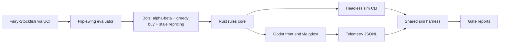

# POC 7: Always For Sale (idea #24)

The prototype proves that Harberger-priced chess has a tax-and-rent setting where both buying and pricing decide games, and that real players actually reprice. Bot self-play has to find that band first, in week 4. Then the Steam Playtest has to show that the median player reprices on at least 10% of turns.

| | |
|---|---|
| Hypothesis | On a 6×6 board with prices 1–12, a contiguous tax-and-rent band makes buyouts happen every 6–10 turns and rewards skill at both buying and pricing, and players use repricing as a real move. |
| Go/no-go metric | Gate A (self-play, week 4) passes when ≥3 adjacent parameter cells meet all of these in a confirmatory run: median gap between buyouts of 6–10 turns; the full bot beats a no-buy ablation and a rote-pricing ablation with win rates ≥60% (95% CI lower bound >55%); draws plus mutual bankruptcies <15%. Gate B (Steam Playtest, week 12) passes when the median qualifying player reprices on ≥10% of their turns. |
| Timebox | 12 weeks |
| Team | 1 systems programmer (Rust rules core, bots, harness); 1 game developer-designer (Godot, UI, relics); a strong chess player for testing (part-time, optional) |
| Rough cost | Estimates: sweep CPU $100–300; Steam Direct $100; placeholder art about $200; optional ads $500–1,000; telemetry hosting about $20 a month. About $1–2k beyond salaries. |
| Depends on | Nothing external, except about 500 Playtest sign-ups |

## What the prototype is (and isn't)

In scope:
- A Rust rules core for 6×6 Los Alamos-style armies. It covers chess legality, buyouts that flip a piece in place (the buyer inherits price and tax), tax on posted prices, centre-square rent, progressive treasury tax, a late tax rising after turn 30, and bankruptcy. Each turn is move, buy, or reprice up to two pieces. Kings are never for sale.
- A flip-swing evaluator and bots: alpha-beta over moves, greedy buys (buy when price is below flip swing), and repricing of the stalest quotes.
- The shared simulation harness (below) and the Gate A sweeps.
- After Gate A only: a Godot run of up to five boards against three bosses (Honest, Monopolist, Batch), ten relics, a shop, post-run receipts (price against flip swing, quote by quote) and opt-in telemetry.

Out of scope:
- Eight-board runs, the Market Maker and inflation bosses, daily runs, replay validation, async PvP, WASM and the classroom licence.
- A live flip-value overlay in play. Flip values appear only in receipts and tutorials, as agreed in the transcript.
- OACP. A single-player game has no cross-owner agents, so nothing here needs it.

## Architecture

**Flip swing** is the owner's evaluation change if a piece flipped in place, converted to coins by a swept scale factor. Coarse sweeps use a fast Rust static evaluation. Confirmatory cells use Fairy-Stockfish at a fixed node limit, scoring FENs only, since it can't search buyouts. The two are rank-checked on 10,000 positions first (target Spearman ≥0.8, an estimate).

**Bot personalities** set price as flip swing times a multiplier (Monopolist ×3). The Batch boss is a rule variant in which buyouts clear together at the end of each round.

**Shared simulation harness (with POC 8).** POC 7 and POC 8 share one sweep harness. Whichever POC starts first builds it, at an estimated 4–6 engineer-days.
- **Contract.** Each game ships a headless CLI. It reads a JSON cell (parameters, bot policy, seed range) and writes one JSONL summary line per game, plus a per-turn event log. This POC's CLI is the Rust core. POC 8's is a .NET console app over its C# core.
- **Orchestration.** A Python 3.12 orchestrator samples cells with `scipy.stats.qmc` (Sobol) and shards seeds across the cores of one cloud VM. Results go to Parquet. Gates are evaluated with DuckDB and bootstrap confidence intervals.
- **Pre-registration.** Gates live in a `gates.yaml` file that is committed and git-tagged before any confirmatory run. Exploratory and confirmatory runs use disjoint seed ranges, which guards against the winner's curse from searching many cells.
- **One analysis layer.** Human playtest telemetry uses the same event schema, so the same code reads bot runs and player runs.

## Stack

- **Rust rules core**, fast enough for millions of games. `rand_chacha` (`ChaCha8Rng`) gives portable seeds; `proptest` tests the rules.
- **Fairy-Stockfish (GPL-3.0)** supports Los Alamos chess and `variants.ini` custom variants. It runs as a separate UCI process for scoring and as a perft oracle.
- **Godot 4.x (current stable) with godot-rust `gdext`**, so the shipped game and the bots share one rules core.
- **The shared Python harness** (`scipy`, Parquet, DuckDB), as described above.
- **Steamworks Playtest** on a coming-soon store page; free beyond Steam Direct.
- **FastAPI ingest to Parquet** for opt-in telemetry, keyed by hashed Steam IDs.

## Milestones

1. **Week 1:** 6×6 move generation and legality, including buys of pinned pieces and buys that expose a king, judged by strict chess legality after the flip. Harness skeleton. Check: perft matches Fairy-Stockfish to depth 4 on 50 positions, and 10,000 random games run without a panic.
2. **Week 2:** the economy, the flip-swing evaluator, the bots and the two ablation bots. Check: seeds reproduce; at least 100,000 games a day per core (estimate).
3. **Week 3:** an exploratory Sobol sweep over tax rate, rent, starting treasury, progressive-tax threshold, late-tax slope and coin scale (256 cells × 500 games). Check: a shortlist of candidate cells.
4. **Week 4:** tag `gates.yaml`, then run the confirmatory run, 2,000 games per comparison per cell, with sides swapped on paired seeds. Check: the Gate A decision. If it fails, stop here.
5. **Weeks 5–6:** one Godot board against Honest; Steam page and Playtest setup. Check: 5 internal testers finish a board.
6. **Weeks 7–8:** Monopolist and Batch, ten relics, the shop, a five-board run, receipts and telemetry. Check: in a 15-person closed test, reprice share and turn time come out of the harness.
7. **Weeks 9–12:** Steam Playtest, recruited through chess-variant forums, the Lichess forum and roguelite communities. Check: Gate B in week 12.

## Go/no-go experiment

**Gate A, self-play.**
- Each candidate cell plays 2,000 paired games per comparison.
  - Full bot against itself, to measure buyout frequency and game health.
  - Full bot against a no-buy ablation, to show buying matters.
  - Full bot against a rote-pricing ablation (price = conventional material value, never reprices), to show pricing matters.
- A band is ≥3 adjacent cells along at least one axis that all pass. A single passing cell is a knife-edge and does not count.
- No band means no game. Stop at week 4.

**Gate B, players.**
- Recruitment target: 500. Qualifying players have ≥2 completed boards, with a floor of 150 qualifying players. If fewer qualify, extend recruitment by 2 weeks.
- The metric is each player's share of turns spent repricing. Gate B passes when the median across players is ≥10%.
- Secondary measures come from the transcript's earlier kill metric. They are reported, not gates.
  - Median turn time should stay ≤45 seconds.
  - By run 5, few players should price by a rote rule. Rote means a regression of price on material value with R² ≥0.9.
- **Outcomes:**
  - A passes, B passes: go.
  - A passes, B fails: players treat prices as setup, not play. Diagnose from receipts and turn times, then stop or try one scoped redesign.

## Risks and mitigations

| Risk | Likelihood | Mitigation |
|---|---|---|
| No band where both buying and pricing matter | Medium | Sweep wide (include reprice limit and coin scale); the decision comes at week 4 before any art |
| Bots don't play like humans | High | Bots only find the band; Gate B measures humans |
| Analysis paralysis from pricing many pieces | Medium | 6×6 board, integer prices, two reprices a turn, turn-time telemetry |
| Buyout edge cases (pins, king exposure) | Medium | Strict chess legality after the flip; perft and property tests |
| GPL-3.0 engine in a commercial build | Medium | Ship as a separate UCI executable with source, or ship the in-house evaluator; legal review before launch |
| Snowballing or turtling | Medium | Progressive treasury tax and late tax are swept knobs; Gate A's health limit catches both |

## If it's a go

- Build full eight-board runs, the Market Maker and inflation bosses, and daily seeded runs with server-side replay validation.
- Submit a demo to a later Steam Next Fest.
- Design async PvP to test the real Akerlof cycle, using the posted-price telemetry already being collected.
