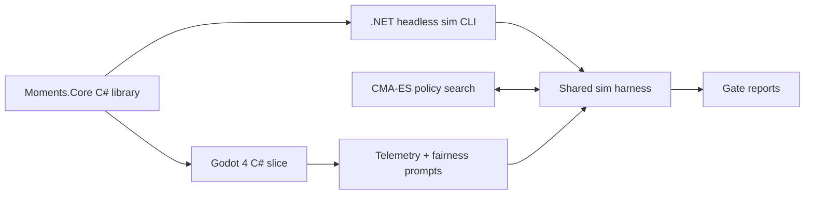

# POC 8: Seventeen Moments (idea #44)

The prototype proves that a fixed 52-slot mind, a ripening queue and frequency-dependent near enemies make a diverse mind the winning strategy, and that players accept counterfeit deaths when the risk was visible. Two numbers decide it: at equilibrium no card holds more than 35% of the mind, and 70% of playtesters rate counterfeit deaths "fair".

| | |
|---|---|
| Hypothesis | Under the ripening queue and the mimicry curve, the best-playing bot keeps a diverse mind, and players who die holding a counterfeit judge the death fair. |
| Go/no-go metric | **Gate 1 (bot harness, week 4).** Across 10,000 confirmatory runs of the optimized bot, the 90th percentile of the largest card-family share of the 52 slots at steady state is ≤35%. **Gate 2 (week 8).** Of 20 roguelite players who suffered at least one counterfeit death, ≥14 (70%) rate those deaths fair (mean rating ≥4 on a 5-point scale). |
| Timebox | 10 weeks: 8 for the two gates, plus 2 to register for Steam Next Fest if it's a go |
| Team | 1 gameplay/systems programmer (C#, Godot); 1 designer-artist (cards, queue UI, placeholder art tells); a Theravāda scholar and a monastic reader (paid review, part-time) |
| Rough cost | Estimates: sweep CPU $100–300; playtester honoraria 24 × $25–40 = $600–1,000; scholar and reader review $1,000–2,000; Steam Direct $100; placeholder art about $200. Total about $2–3.5k. |
| Depends on | Scholar and monastic reader availability before card text is final; about 24 roguelite players (from r/roguelites and deckbuilder Discords) |

## What the prototype is (and isn't)

In scope:
- **Rules core**, a C# library with no Godot dependency: the 52-slot mind; habit cards that auto-play unless sati is spent; the ripening queue, which overwrites the oldest slot; an overwritable sati slot; one unoverwritable breath per turn; insight uproots and retreat nodes; near-enemy twins with risk shown on each queue entry; and the last javana choosing the realm, with deathbed chanting and the death reveal.
- **Content.** One realm and 40 card types, including the Visuddhimagga pairs mettā/attachment, compassion/pity and equanimity/indifference.
- **Paper prototype.** A 13-slot paper mini-mind in week 1, to feel out the queue decision.
- **Harness and slice.** The shared harness (below) for Gate 1, and a Godot slice on the same core for Gate 2.

Out of scope:
- More realms, all 52 factors as cards, daily runs, Switch, tradition rule sets and final art.
- Any wellbeing or therapeutic claim, now or later.
- OACP. A single-player game has no cross-owner agents, so nothing here needs it.

## Architecture

**Tuning knobs:** ripening delay; the mimicry curve (a logistic in a card's share of recent plays, with ceiling, midpoint and slope); sati regeneration; insight cost; retreat-node frequency.

**Bots:**
- **Spam bot** plays the highest immediate-value card. **Noisy bot** spends sati at random.
- **Optimized bot.** A parameterized policy covering card preferences, sati thresholds on the counterfeit risk shown, and uproot priorities, tuned by CMA-ES to maximize run depth. "Equilibrium" means the optimized bot's policy after the search converges, measured over the last 25% of turns of long runs, once the largest family share drifts by less than 1 point between windows.
- **Monoculture probe:** the best policy forced to keep one family at ≥50%. It should score clearly below the optimum.

**Card families.** A wholesome card and its near-enemy twin share a name and art, so a player sees them as one card. The 35% gate is therefore applied to families. Per-card shares are reported as well.

**Shared simulation harness (with POC 7).** POC 7 and POC 8 share one sweep harness. Whichever POC starts first builds it, at an estimated 4–6 engineer-days.
- **Contract.** Each game ships a headless CLI. It reads a JSON cell (parameters, bot policy, seed range) and writes one JSONL summary line per game, plus a per-turn event log. POC 7's CLI is its Rust core. This POC's is a .NET console app over the C# core.
- **Orchestration.** A Python 3.12 orchestrator samples cells with `scipy.stats.qmc` (Sobol) and shards seeds across the cores of one cloud VM. Results go to Parquet. Gates are evaluated with DuckDB and bootstrap confidence intervals.
- **Pre-registration.** Gates live in a `gates.yaml` file that is committed and git-tagged before any confirmatory run. Exploratory and confirmatory runs use disjoint seed ranges, which guards against the winner's curse from searching many cells.
- **One analysis layer.** Human playtest telemetry uses the same event schema, so the same code reads bot runs and player runs.
- **Extra for this POC:** a CMA-ES policy-search loop (`cma` package).

## Stack

- **.NET 8 class library** for the rules. Godot loads the same assembly the CLI runs, so bots and players play identical rules.
- **A hand-written xoshiro256\*\* RNG.** `System.Random`'s seeded output is not guaranteed stable across .NET versions, and daily runs need it to be.
- **Godot 4.x (current stable, .NET build)** for the slice, as the record specifies.
- **The shared Python harness** (`scipy`, Parquet, DuckDB) plus `cma` for CMA-ES.
- **itch.io restricted page or Steam keys** for the playtest build, with an in-game fairness prompt and an exit survey.

## Milestones

1. **Week 1:** paper mini-mind sessions; core and harness skeletons. Check: in paper play, people read the queue before spending sati.
2. **Week 2:** the core holds all 40 cards and the CLI and bots run. Check: one seed gives the identical log on Windows and Linux; at least 1M runs a day on the VM (estimate).
3. **Week 3:** exploratory Sobol sweep over the knobs, then CMA-ES in the promising cells. Check: a shortlist of cells where the optimized bot beats the spam bot.
4. **Week 4:** tag `gates.yaml`, then run 10,000 confirmatory runs. Check: Gate 1. Stop if it fails.
5. **Weeks 5–6:** Godot slice with queue risk display, sati inspection, placeholder art tells and the death reveal; scholar and reader review card text. Check: 3 internal testers finish a run; review signed off.
6. **Weeks 7–8:** the 20-player playtest, before the December holidays. Check: Gate 2.
7. **Weeks 9–10, if it's a go:** Steam Direct, the store page, and registration for Next Fest February 2027. Registration closes 10 January 2027.

## Go/no-go experiment

**Gate 1 (week 4), pre-registered in `gates.yaml`.**
- Run 10,000 runs of the optimized bot in the chosen cell on fresh seeds.
- The metric is the largest card-family share at steady state for each run. It passes when the 90th percentile is ≤35%.
- Reported, not gating: per-card shares, the monoculture probe's gap, and the sati death-spiral rate (sati slot lost and never regained).
- Fail means the mimicry curve doesn't stop monoculture at any tested setting. That is the core design claim, so stop.

**Gate 2 (weeks 7–8).**
- Recruit 24 consenting adult roguelite players for 60–90 minutes each.
- After each death the game asks "Was this death fair?" (5-point scale), and the log records whether a counterfeit was held or was the last javana.
- Only players with a counterfeit death count; recruit until 20 qualify. A player counts as fair if their mean rating over counterfeit deaths is ≥4. Pass at ≥14 of 20.
- Secondary measure, from the transcript's earlier kill metric: sati spends should cluster around queue decisions (inspect, or withhold assent on a high-risk entry) rather than random swaps. Target ≥60% (estimate), reported but not gating.
- **Outcomes:**
  - Both pass: go.
  - Gate 2 fails: this is the hidden-information quit risk the transcript named. Allow one round of stronger tells and a richer death reveal, retested on 20 new players at the same threshold.

## Risks and mitigations

| Risk | Likelihood | Mitigation |
|---|---|---|
| Monoculture survives the mimicry curve | Medium | Family-level gate; monoculture probe; wide sweep over curve shape |
| Counterfeit deaths feel unfair | Medium | Risk shown on each queue entry; sati inspect; art tells; the death reveal shows the risk the player saw |
| Onboarding load from 52 slots and Pāli | High | Plain-English names, Pāli in tooltips, a tutorial fight |
| Sati-loss death spiral | Medium | The unoverwritable breath and retreat nodes; the harness reports the spiral rate |
| Religious or cultural offence | Medium | Scholar and monastic review before the playtest; no Buddha images as loot; no wellbeing claims |

## If it's a go

- Ship a demo for Next Fest (22 February to 1 March 2027): Press Preview builds are due 25 January and review items by 8 February. The market bar is about 30,000 wishlists.
- Add a second realm and daily seeded runs, then plan the Switch port.
- Prototype one tradition rule set (Stoic assent) in the harness and compare mind diversity across rule sets, as the moonshot proposes.
