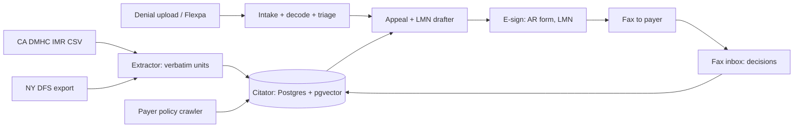

# POC 9: Precedent (idea #1)

The prototype tests whether a patient-side appeals agent can get prescribers to sign a pre-filled letter of medical necessity (LMN) fast enough for a patient-only flow to work. It runs 200 live GLP-1 and specialty-drug appeals, with arguments drawn only from published external-review decisions. The deciding number is the share of LMN packets signed within 7 days. Under 50% means Precedent pivots to a provider-side tool.

Precedent prepares and files paperwork. It is not legal or medical advice. Clinical claims come from the prescriber's signed letter, and counsel reviews every legal template.

| | |
|---|---|
| Hypothesis | Prescriber offices sign and return a pre-filled, citation-backed LMN packet within 7 days at least half the time. |
| Go/no-go metric | Of LMN packets delivered for eligible live appeals (n = 200), the share returned signed within 7 calendar days. 50% or more is a go. Under 50% means pivot to a provider-side tool. |
| Timebox | 12 weeks |
| Team | 2 engineers (full-stack, data/ML), a part-time pharmacist and part-time insurance lawyer, and a patient-advocacy partner |
| Rough cost (estimates) | Pharmacist and lawyer: $15-25k. Partner stipend: $10-20k. Cloud, LLM, OCR, fax and e-signature, all under BAAs: $4-6k. Total: about $30-50k. |
| Depends on | An advocacy partner (to be signed), vendor BAAs, and the public CA DMHC and NY DFS data |

## What the prototype is (and isn't)

In scope:
- GLP-1 and specialty-drug denials on commercial plans from three payers, for CA and NY residents.
- A citator of verbatim argument units, each linked to its source decision. A pharmacist and a lawyer audit 300 of them.
- Denial intake, CARC/RARC decoding and triage. Benefit exclusions are not medical-necessity disputes, so those patients are told plainly and pointed to cash-pay options.
- Authorized-representative (AR) e-signature, an appeal draft, an LMN packet sent to the prescriber, a deadline tracker, and a fax inbox for decision letters.

Out of scope:
- Win odds shown to users and the overturn-rate report for regulators. Both were killed in the transcript because of selection bias.
- Mining ERISA claim files. The POC only files the request under 29 CFR 2560.503-1 and logs whether a file arrives.
- The citator API, pharma integrations, and other states. Washington residents are excluded because of the My Health My Data Act.

## Architecture

**Public decisions (checked 24 Oct 2026).**
- **CA DMHC IMR:** a single CSV on data.chhs.ca.gov ("Independent Medical Review (IMR) Determinations, Trend"), with a data dictionary. It holds 42,749 decisions from 2001 to 2026. Columns include diagnosis and treatment categories, Determination, Type, and a free-text **Findings** field with the reviewer's reasoning. It does **not** name the plan. There are 11,948 pharmacy rows, and 1,835 name a GLP-1 drug (1,556 of those overturned).
- **NY DFS:** searchable at dfs.ny.gov/public-appeal/search, covering decisions from 31 May 2019. The "Export all data by year (Excel)" link (myportal.dfs.ny.gov/o/peasa/peasaserviceexcel) returned 63,329 rows. Columns include **Health Plan**, **Denial Reason**, Summary 1-4 and References 1-4. 1,780 rows name a GLP-1 drug. The top plans are Aetna, Excellus, Highmark, Anthem and Fidelis.
- Only NY names the plan. Payer-policy matching therefore works on NY units, and CA units transfer by argument.

**Extractive only.** A unit is a span of the Findings or Summary text, stored with its offsets, the case ID and a sha256 of the source row. The LLM proposes spans and tags. Drafts may cite stored spans only.

**Status.** In the POC, statuses are rule-based. *Superseded* means the payer policy in force on the date of service changed the criterion. *Distinguished* means later decisions on the same criterion went the other way, and a reviewer confirms it.

**OACP fit (post-POC).** The citator could run as an OACP agent that provider-side prior-auth agents find with `GET /discover`. It would publish a `lookup_arguments` action spec with an `input_schema` (drug, criterion, payer, denial reason, no PHI). The registry validates stranger requests against that schema (RFC 005). Each returned unit would carry an RFC 007 assertion with `status: "reported"` (Precedent relays what the review body decided), an `evidence_digest` (the source row's sha256) and `observed_at`. PHI stays out of OACP payloads (SPEC §8). The token and escrow endpoints in SPEC §9 are experimental, so licensing would be billed outside OACP.

## Stack

- **Python + FastAPI**: one language for extraction and the API.
- **Postgres + pgvector on AWS RDS** under the AWS BAA.
- **Claude on Amazon Bedrock** (HIPAA-eligible) for tagging and drafting. Outputs are schema-checked, and spans are verified before anything is sent.
- **AWS Textract** for OCR of denials and inbound faxes.
- **Documo (mFax) Business tier or Sinch Fax API.** Both advertise BAAs. Confirm inbound webhooks in week 1.
- **Dropbox Sign or DocuSign** on a BAA plan.
- **Flexpa** (optional) for EOBs and coverage from Patient Access APIs.
- **Playwright crawler** that keeps dated snapshots of the three payers' drug policies.
- **Rule-based deadline engine:** ERISA's 180-day appeal window and 30-day pre-service decisions, plus state external-review windows.

## Milestones

1. **Week 1:** Pick the three payers from the NY plan counts, sign BAAs, and draft the templates with counsel. *Check:* BAAs signed and templates approved.
2. **Weeks 2-3:** Ingest both corpora and extract GLP-1 and specialty units. *Check:* every unit resolves to its source row and offsets.
3. **Week 4:** The 300-unit audit. *Check:* at least 95% rated faithful by both auditors, and zero fabricated citations. A fabricated citation stops the work until it is fixed.
4. **Weeks 5-6:** Intake, triage, drafter and crawler. *Check:* the pharmacist reviews 20 de-identified past denials from the partner.
5. **Weeks 7-8:** AR flow, LMN packet, fax round trip and deadlines, plus the pre-registration. *Check:* the end-to-end test passes, and the pre-registration is filed.
6. **Weeks 9-12:** 200 live appeals. *Check:* the go/no-go readout.

## Go/no-go experiment

- **Pre-register by week 8:** the metric, the denominator, the 7-day clock, the exclusions and the threshold, as a dated, hashed document.
- **Sample:** 200 eligible appeals from the partner. Eligible means a commercial plan from one of the three payers, a CA or NY resident, and a medical-necessity, step-therapy or formulary-exception denial.
- **Procedure:** The patient signs the AR form. The prescriber's office gets a one-page pre-filled LMN, 2-4 quoted argument units with links, and both an e-sign link and a fax-back option. One reminder goes out on day 3, and there is no other contact.
- **Measure:** the time from delivery confirmation to a signed LMN. An LMN the prescriber edits and then signs counts as signed. Withdrawals before delivery are excluded and reported.
- **Decide:** 50% or more is a go. Under 50% means pivot. At n = 200 the 95% confidence interval is about ±7 points, and it is reported with the result.
- **Also reported, but not deciding:** median time to signature, decision letters received by fax, and the overturn rate, labelled as selection-biased.

## Risks and mitigations

| Risk | Likelihood | Mitigation |
|---|---|---|
| Prescribers don't sign | Medium-high | This is the experiment. Keep the packet short, offer two return channels, send one reminder. |
| A misquoted or invented citation | Medium | Extractive spans, an offset check before sending, and the audit. |
| CA data doesn't name plans | Certain | Match by argument in CA and by payer in NY, and tell users. |
| PHI law for a non-covered entity (FTC HBNR, WA MHMDA) and claims-adjuster licensing | Medium | BAAs throughout, exclude WA, get a counsel opinion before week 9, and run through the partner. |
| Too few cases in 4 weeks | Medium | Start recruiting in week 5, add a second partner, and extend 2 weeks with the threshold unchanged. |
| Patients read citations as promises | Medium | No odds, a "not legal or medical advice" notice on every screen, and weak cases told plainly. |

## If it's a go

- Extend to ERISA plans by mining the requested claim files, including the internal rules relied on (29 CFR 2560.503-1(m)(8)).
- Pilot the citator API with one specialty pharmacy or PA team, using the OACP interface above.
- Add more states with published decisions, and decide whether the corpus goes into a nonprofit trust.
- On a no-go, repackage the citator and drafter for prescriber offices.
