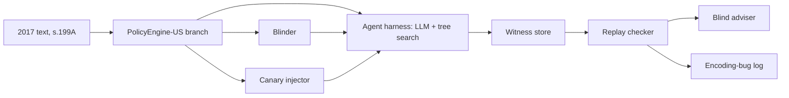

# POC 10: Dry Run (idea #50)

The prototype is a backtest. We encode section 199A as written in the 2017 TCJA, before the 2018 fix, and set LLM red-team agents on it. The question is whether they find the "grain glitch" and submit it as a replayable witness. The deciding number: a valid grain-glitch witness on a blinded encoding within 72 hours of compute. If agents can't find a known exploit in pre-enactment text, nothing else in Dry Run matters.

| | |
|---|---|
| Hypothesis | LLM agents searching fact patterns and elections against a faithful encoding of pre-fix section 199A will find the grain glitch without being told it exists. |
| Go/no-go metric | On the blinded arm, a valid grain-glitch witness within 72 wall-clock hours on a fixed pool of 8 agent workers. Valid means it replays, cites statutory text at each step, and is confirmed by a blind tax adviser. In addition, at least 3 of 5 planted canary exploits must be found, so that a pass is not just recall. |
| Timebox | 5 weeks |
| Team | 1 engineer (Python, PolicyEngine), 1 ML engineer (agent search), and a part-time tax adviser (CPA or tax lawyer) |
| Rough cost (estimates) | LLM API for 3 arms × 72 hours: $3-8k. Compute: under $500. Adviser at about 40 hours: $8-12k. Total: about $12-20k. |
| Depends on | Nothing external. Public statute text and open-source PolicyEngine-US. |

## What the prototype is (and isn't)

In scope:
- A PolicyEngine-US branch that encodes section 199A as enacted by P.L. 115-97 (22 December 2017, from the conference agreement in H. Rept. 115-466). It covers only what that section touches: taxable income, net capital gain, QBI, W-2 wage and UBIA limits, the SSTB phase-in, and qualified cooperative dividends.
- The witness format, a replay checker, and an agent search harness.
- Three arms (original, blinded, canary) and a log of encoding bugs.

Out of scope:
- The UK any% board, embargoed disclosure, the HMRC report, bounties, revenue-at-stake microsimulation, the agent-based model and CGE layers, and any legislature opt-in.
- Real taxpayer data. The backtest uses synthetic households only.

## Ground truth: the grain glitch

As enacted, section 199A had two parts:
- **20% of qualified business income (QBI).** QBI is computed **net**. The deduction is capped at 20% of taxable income above net capital gain and limited by W-2 wages and UBIA.
- **20% of qualified cooperative dividends** (§199A(a)(2), defined in (e)(4)). These include per-unit retain allocations, so the base is effectively **gross** sales to a co-op. This part was capped at taxable income less net capital gain, with no wage or UBIA limit.

In the Tax Foundation's example, a farmer with $2M of grain sales to a co-op and $400k of net income gets a $400k deduction and owes no federal income tax. Selling the same grain to an independent buyer gives an $80k deduction. Congress replaced this in the Consolidated Appropriations Act, 2018 (P.L. 115-141, Division T, 23 March 2018). The fix brought in a hybrid patron deduction and a pass-through of up to 9% of the co-op's QPAI.

PolicyEngine-US models the main QBI path (policyengine-us 2.62.4 on PyPI, checked 24 October 2026). That covers `qbid_amount`, `qualified_business_income_deduction`, and the wage, UBIA and SSTB parameters under `parameters/gov/irs/deductions/qbi/`. It has no cooperative-dividend variables, so the branch adds them from the 2017 text. In week 1 the adviser checks the branch against the enrolled text.

## Architecture

- **Witness:** a JSON record with these fields:
  - `fact_pattern`: a PolicyEngine situation.
  - `elections`.
  - `baseline_pattern`: an economically matched alternative.
  - `steps[]`: each computed variable, with the statutory text it relies on quoted.
  - `encoding_commit` and `liability_delta`.
  - `replay_hash`: a sha256 over the inputs, the commit and the outputs.
- **Replay checker:** reruns the witness on the pinned commit and rejects any step without a citation. A witness that is valid under the encoding but wrong in law is logged as a bug report, never as a find.
- **Harness:** LLM proposers suggest fact patterns and elections, and Monte Carlo tree search explores entity and sales-channel choices. The reward is the liability drop against the matched baseline. There is no web access, and the prompts do not mention cooperatives.
- **Contamination is the central threat**, because models have read about the grain glitch. Three arms run:
  - **Original:** the real text. This measures recall.
  - **Blinded (scored):** "cooperative", "patron", "per-unit retain" and "grain" are replaced with neutral defined terms, and subsection numbers are shuffled.
  - **Canary:** five plausible exploits planted in other synthetic provisions by a second engineer and hidden from the harness team.

**OACP fit (for the board, not the backtest).**
- A `dry-run-referee` agent on a self-hosted registry advertises a `submit_witness` action spec with an `input_schema`. Under RFC 005, the registry validates stranger `task_request`s against it.
- Stranger requests must be unsealed (RFC 005 §2), so submitters open threads at the `private` tier. That hides the contents from observers (RFC 001 §2), and only the Dry Run operator reads them, which suits embargoed disclosure. After a friend code (RFC 002), payloads are sealed by default (RFC 004).
- The Ed25519 envelope signature (SPEC §5.4) binds each witness to its author.
- The referee replies with a `task_result` carrying an RFC 007 `measured` assertion ("replays, delta $X on commit abc"), with `evidence_digest` set to `replay_hash`. Encoding-bug challenges use `POST /assertions/dispute`.
- **Extensions needed:**
  - Signed sender timestamps for priority. The registry timestamp is unsigned (SPEC §5.2, §8).
  - Timed embargo release.
  - Bounty payouts. The SPEC §9 token economy and escrow are experimental.

## Stack

- **PolicyEngine-US on policyengine-core** (an OpenFisca-Core fork). It already encodes US federal tax, including QBI, with YAML tests. OpenFisca itself is covered through policyengine-core.
- **Catala** (CatalaLang/catala) for an independent encoding of §199A(a), (b) and (e)(4) only. A witness counts only if both encodings agree, which catches encoding bugs.
- **Python asyncio harness.** It uses Claude Sonnet-class models via the API, with token caps per worker, and plain Monte Carlo tree search over a typed action grammar.
- **Postgres** for witnesses and logs, and **pytest** for replay tests.

## Milestones

1. **Week 1:** Encode pre-fix 199A with YAML tests against the Tax Foundation and Iowa State CALT examples. The canaries are built in secret. *Check:* the adviser signs off on the citations, and the tests pass.
2. **Week 2:** Build the Catala cross-encoding, the witness schema, the replay checker and the blinder. *Check:* a hand-written grain witness replays on both encodings, and the adviser finds the blinded text coherent.
3. **Week 3:** Run the harness on the current-law (post-fix) encoding. *Check:* zero grain-type witnesses, which is the false-positive control. File the pre-registration.
4. **Week 4:** Three parallel 72-hour runs on identical budgets. *Check:* complete logs, and every witness replayed.
5. **Week 5:** Blind adjudication and the readout. *Check:* the decision is made against the pre-registration.

## Go/no-go experiment

- **Pre-register (end of week 3):** the arms, the budgets (8 workers, 72 hours, a token cap), the prompts, what counts as a find, and the threshold. Hash it and post it publicly.
- **Valid find:** a witness in which a seller to the defined purchaser class gets a deduction above 20% of net business income, driven by the cooperative-dividend clause rather than an encoding bug. The adviser judges each candidate without seeing its arm or the logs.
- **Go:** the blinded arm finds it within 72 hours, **and** at least 3 of 5 canaries are found.
- **Partial:** only the original arm finds it, which suggests recall rather than search. Or the canaries are found but the glitch is not. Fix the search and rerun once.
- **No-go:** still failing after the rerun. Do not open the UK board.
- **Also reported:** time to first find, the false-witness rate, bug reports filed, and the cost per valid witness.

## Risks and mitigations

| Risk | Likelihood | Mitigation |
|---|---|---|
| Agents recall the glitch rather than find it | High | Blinded scored arm, canaries, no web access. |
| The encoder leaks or omits the glitch | Medium | Encode from the text alone, then adviser review and the Catala cross-check. |
| False witnesses from encoding bugs | High | Quoted citations at each step, two-encoding agreement, blind adjudication. |
| Blinding destroys the meaning | Medium | Adviser readability check, with consistent defined terms. |
| Budget overrun | Low | Hard token caps per worker. |

## If it's a go

- Open an any% board on the next UK draft Finance Bill clauses (published in summer for technical consultation), encoded in PolicyEngine-UK, with intake through OACP under embargo.
- File a ranked dry-run report in that consultation, with prevalence from FRS-based microsimulation.
- Build the OACP extensions listed above.
- Approach one legislature about safe harbours and roll-call votes.
