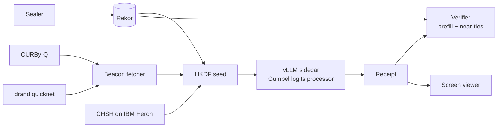

# POC 11: One Take (idea #10)

The prototype seals an open-weight model's sampler. Each pass@1 answer is decoded from Gumbel noise derived from a Bell-certified CURBy pulse that didn't exist when the policy was committed, and anyone can verify it with one prefill pass. Two numbers decide it. Shared noise must cut the variance of pass@1 differences by at least 30%, and near-ties that break verification must stay at or below 1% of tokens.

| | |
|---|---|
| Hypothesis | A batch-invariant vLLM sampler keyed by CURBy, drand and a Rekor commit yields receipts that verify across hardware, and shared ("duplicate") noise makes model comparisons measurably tighter. |
| Go/no-go metric | Pre-registered, on 5 Qwen3 models × GSM8K (1,319 items) × 20 noise sets. (1) The median variance reduction in pairwise pass@1 differences, shared vs. independent noise, is at least 30%. (2) Near-ties that break verification are at most 1% of tokens on a second GPU type. If either fails, it's a no-go. |
| Timebox | 12 weeks |
| Team | 1 ML systems engineer (vLLM, PyTorch). 1 engineer with applied-cryptography experience (half time). 1 quantum-information advisor (a few hours a week) for the ceremony and the physics copy. |
| Rough cost | Estimates: $1–2K of rented GPU time. $0 for CURBy, drand and public Rekor. $0 for IBM on the Open Plan; one 10-minute run at the pay-as-you-go rate of $96/min would be about $960. |
| Depends on | Public services only: CURBy, drand quicknet, Sigstore Rekor and an IBM Quantum Open Plan account. |

## What the prototype is (and isn't)

In scope:
- A vLLM sidecar on dense open weights (Qwen3, and Llama 3.1 8B as a cross-family check) in batch-invariant mode, with Gumbel-max sampling.
- Sealing. One policy commit (weights digest, tokenizer, prompts, grader, sampler code, τ and top-p, vLLM version) and per-item slots go to Rekor *before* the target pulse. Any change is a public fork, and the receipt shows the take count.
- Verified fetching of CURBy's quantum (DIRNG) chain and of drand quicknet.
- A receipt format, an offline verifier, a branch-screen viewer and CHSH ceremony #1.

Out of scope: closed APIs, MoE models (routing makes near-ties worse), hiring products, the counterparty-nonce flow, and paid reports. OACP is also out: Rekor is the log, and nothing here needs agents owned by different people to message each other.

**Physics honesty, printed on every receipt and page:**
- Quantum randomness makes no answer better or more correct. Every receipt says *unchosen, not right*.
- Against the operator, drand plus a prior commit already stops seed grinding. CURBy guards against a beacon whose future can already be computed: drand rounds are BLS signatures under a key fixed at the DKG, so a colluding threshold can compute future rounds today. A Bell-certified bit didn't exist until it was measured. Without CURBy, the receipt is stamped **classical take**.
- The CHSH ceremony runs on one IBM chip, assuming locality and IBM's honesty. It is a demonstration, not certification.
- The screen is a Monte Carlo histogram, not amplitudes. Physics chose *which* dot, and sampling drew the pattern.

## Architecture

Each slot names its pulses by rule, never by choice: the first CURBy quantum round and the first drand round after the slot's log timestamp. Once both are verified:

`seed = HKDF-SHA256(ikm = CURBy ‖ drand ‖ slot_commit, salt = month's ceremony salt, info = "one-take/v0")`

A ChaCha20 stream keyed by the seed and the token position gives one uniform per vocabulary entry, which becomes g = −log(−log u). A vLLM custom logits processor adds g to the masked logits/τ, and decoding runs greedy, so vLLM's sampler is never forked. The noise depends on the item and position, not on the model. That lets models in one tokenizer family sit the same item against the same noise. The verifier checks Rekor inclusion and time order, re-verifies the pulses and rebuilds the noise. One teacher-forced prefill then confirms every token was the argmax, and positions with a margin below a calibrated δ are listed as near-ties.

## Stack

- **vLLM with `VLLM_BATCH_INVARIANT=1`** for bitwise-deterministic inference. The current docs support NVIDIA compute capability 8.0 and up (A100, L40S, H100).
- **Qwen3 0.6B–14B in non-thinking mode** (Qwen recommends τ 0.7, top-p 0.8). They share a tokenizer, which noise-level common random numbers (CRN) need.
- **`@buff-beacon-project/curby-client` 1.2.0 (`DIRNGClient`).** CURBy's official client. It validates signatures and the causal ordering of the Bell and seed pulses, but *not* the DIRNG certificate or the extraction. For those the fetcher also runs CURBy's `curby_verify`, and the receipt records which checks ran.
- **`drand-client`** for quicknet, with BLS verification.
- **sigstore-python and public Rekor.** Week 5 confirms whether the current Rekor version gives integrated time or needs an RFC 3161 timestamp from Sigstore's TSA. Either way, the receipt needs a trusted time before the pulse.
- **Python `cryptography`** for HKDF and ChaCha20, with a GPU PRF as the fallback.
- **PyTorch and transformers** for the verifier's prefill. **lm-eval-harness GSM8K** for items and grading. **Observable Plot** for the static viewer.
- **Qiskit 2.x and `qiskit-ibm-runtime`**, following IBM's CHSH tutorial.

**IBM Open Plan (checked 2026-10-24):** 10 QPU minutes per 28-day rolling window, us-east only, at most 3 jobs queued. Pay-as-you-go is $96/min. A CHSH run needs only seconds. The plan is meant for learning, so recheck the terms before a paid product relies on it.

## Milestones

1. **Weeks 1–2: sampler.** *Check:* bitwise-identical tokens across batch sizes, and over 10K toy draws the Gumbel frequencies match vLLM's native sampler (chi-square).
2. **Weeks 3–4: verifier.** Measure logit drift between decode and prefill on the same GPU and on a second GPU type. *Check:* δ is frozen before the main run.
3. **Weeks 5–6: sealing and beacons.** Commits, fetchers, HKDF and the classical-take fallback. *Check:* receipts verify on a clean machine, each tampered field fails its own check, and a slot logged after its pulse is rejected.
4. **Weeks 7–8: ceremony and screen.** CHSH #1, with settings drawn from a drand round. Publish the job ID, raw counts and S with its CI. Build a viewer with 1,000 sibling branches plus pinned paraphrases. *Check:* S > 2 with the CI excluding 2 (about 2.5 expected; the ideal is 2√2 ≈ 2.83).
5. **Weeks 9–11: the duplicate-noise run**, pre-registered and sealed on Rekor.
6. **Week 12: analysis and decision.**

## Go/no-go experiment

**Pre-registration.** File on OSF and seal on Rekor before the run: the models, τ and top-p, R = 20, δ, the code and the thresholds.

**Design.** Five Qwen3 models (10 pairs) decode all 1,319 GSM8K test items under 20 noise sets, about 132K generations. *Shared:* models A and B are compared on the same set r. *Independent:* A's set r is compared with B's set r + k (mod 20), averaged over k. Both conditions reuse the same generations.

**Test 1 (CRN).** For each pair, D_r = pass@1_A(r) − pass@1_B(r), and the reduction is 1 − Var(D_shared)/Var(D_indep), with an item-bootstrap CI. **Pass:** the median over the 10 pairs is at least 30%. The answer-level Llama/Qwen result is reported but doesn't decide.

**Test 2 (verification).** Re-verify every token on a second GPU type, with the same type as a control. **Pass:** near-ties (margin < δ) whose argmax flips are at most 1% of tokens. Any flip outside a near-tie is a bug and blocks the decision until it is fixed. The share of fully verified sequences is also reported.

**Outcomes.** Both pass: go. Test 1 fails: duplicate evaluation doesn't pay, so no-go. Test 2 fails: receipts don't verify cheaply across hardware, so no-go until cross-hardware kernels (RepOps, TOPLOC) mature.

## Risks and mitigations

| Risk | Likelihood | Mitigation |
|---|---|---|
| Float drift causes too many near-ties | Medium | Dense models only. δ frozen in advance. Near-ties are listed, not hidden. |
| CURBy is unavailable or uncertified for a round | Medium | Pulses are chosen by rule. The drand-only fallback is stamped **classical take**. Both CURBy checks are recorded. |
| "Certified" is read as "correct", or CHSH is oversold | High | The fixed copy above, reviewed by the advisor. |
| Retakes hide under fresh identities or prompt variants | Medium | Forks are counted per signing identity, and the benchmark issues slots. The limit is stated openly. |
| IBM Open Plan terms change | Low | The ceremony needs seconds of QPU time, and pay-as-you-go is budgeted. |
| Labs that publish forks compete with labs that hide them | High | Afterwards, target benchmark operators that can require receipts. |

## If it's a go

- Integrate with lm-eval-harness and hosted sealing for one benchmark operator willing to require receipts.
- Measure near-ties on MoE models, run cross-family answer-level CRN, and add counterparty nonces.
- Optionally, a verifier agent could publish results as OACP RFC 007 assertions (`status: measured`, `evidence_digest`: the receipt's sha256). This fits RFC 007's digests-only rule, and results become disputable through `POST /assertions/dispute`.
